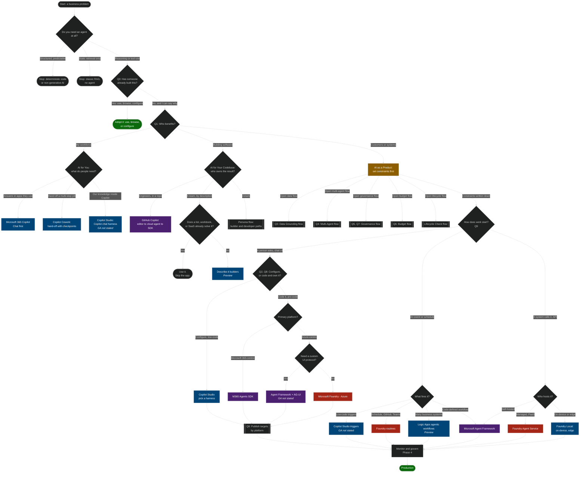
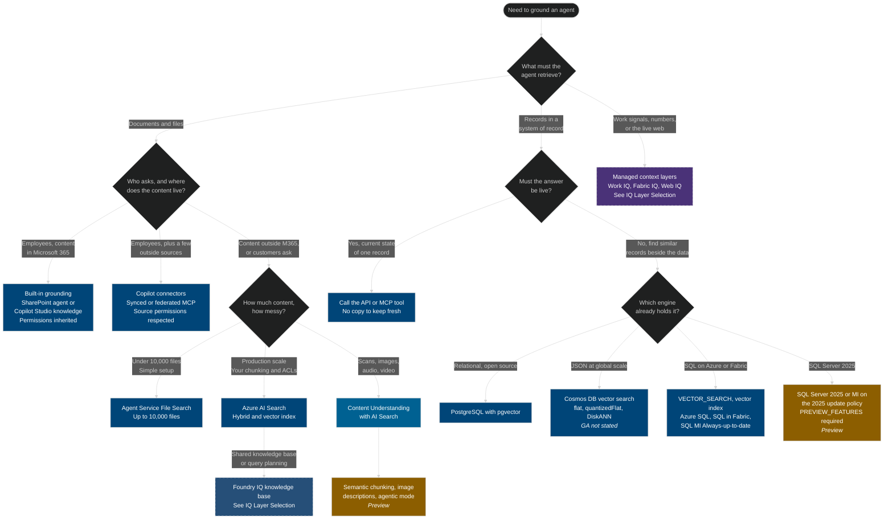
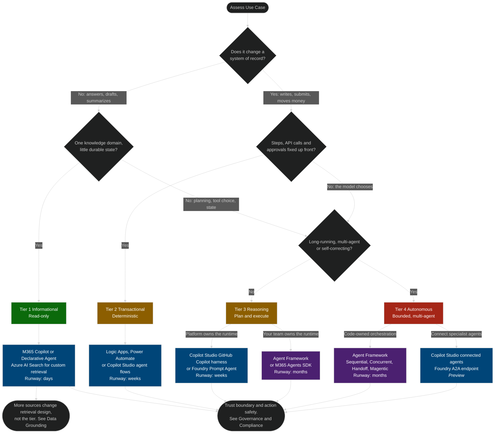
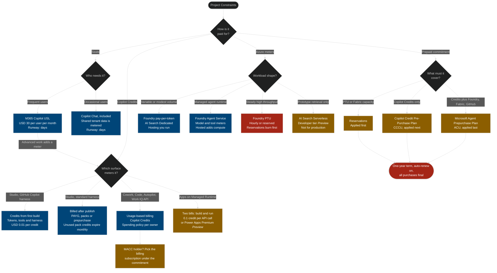
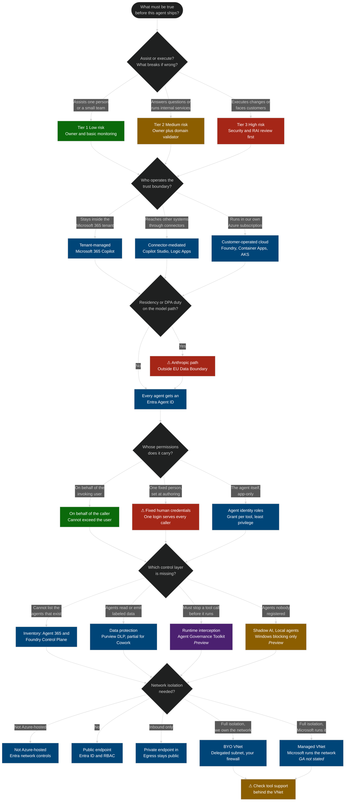
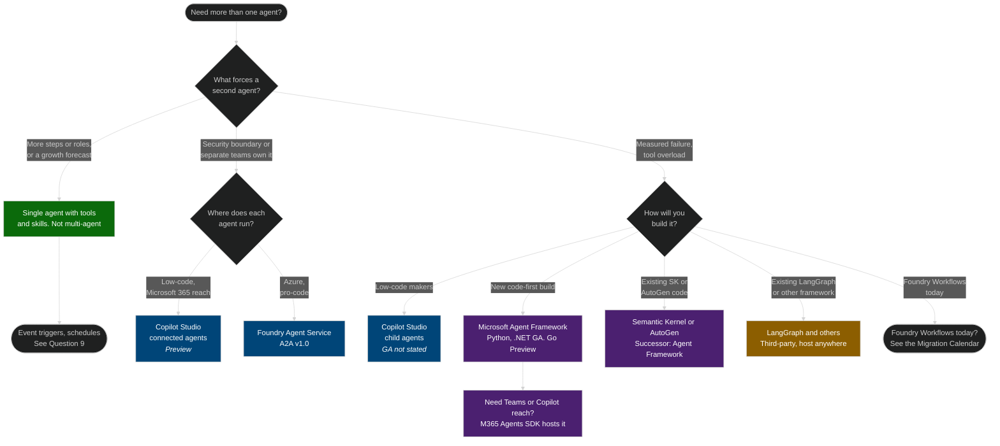
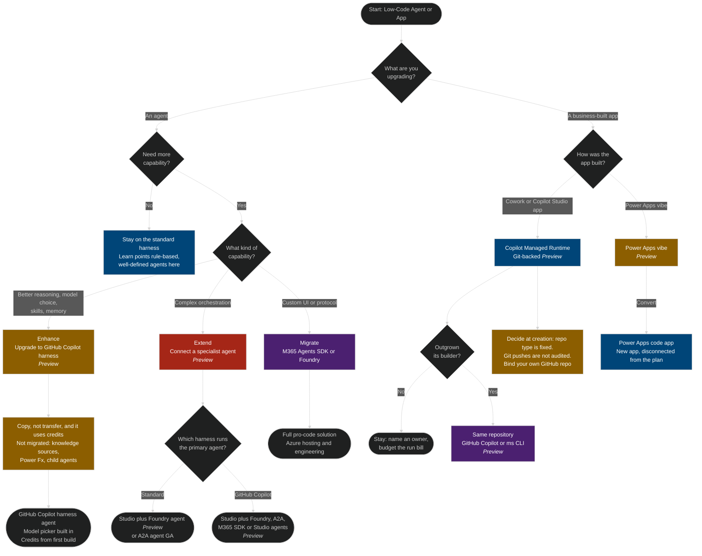
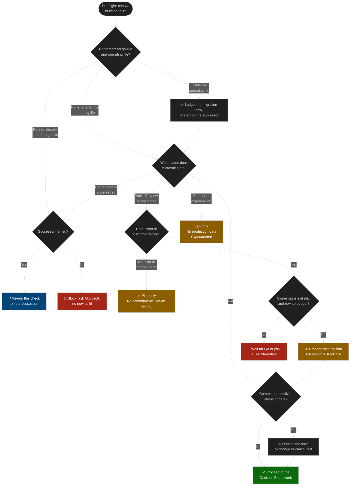
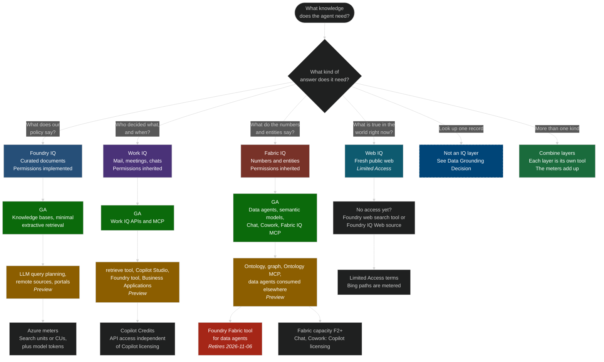

# Visual Framework
{: .no_toc }

Interactive decision trees to guide Microsoft AI technology selection.
{: .page-subtitle }

{: .note }
Use these diagrams after working through the [Decision Framework]({{ '/docs/decision-framework' | relative_url }}) and [Evaluation Criteria]({{ '/docs/evaluation-criteria' | relative_url }}). They reinforce the nine critical questions and are designed to support workshops, architecture reviews, and executive readouts.

## Table of contents
{: .no_toc .text-delta }

1. TOC
{:toc}

---

## Diagram Index

| Diagram | Purpose | Maps To Framework |
|---------|---------|-------------------|
| **1. Complete Decision Flow** | End-to-end technology selection: agent checkpoint, Q0 buy-before-build gate, the 3 AI Buckets, and platform routing | [Phase 2: Q0 to Q9]({{ '/docs/decision-framework#phase-2-technology-groupings-question-0--nine-critical-questions' | relative_url }}) - All critical questions |
| **2. Persona-Based Flow** | Role on-ramps decided by runtime ownership (Maker harnesses, Business Builder apps, Developer loop) | [Phase 2: Q2]({{ '/docs/decision-framework#question-2-the-spectrum-of-control-build-style' | relative_url }}) and [Q8]({{ '/docs/decision-framework#question-8-team-skills--ownership' | relative_url }}) + [Scenarios]({{ '/docs/scenarios' | relative_url }}) |
| **3. Data Grounding Decision** | Question shape, trust boundary, retrieval store, and vector engine | [Phase 2: Q3]({{ '/docs/decision-framework#question-3-data-grounding-pattern' | relative_url }}) - Data grounding patterns |
| **4. Complexity Assessment** | The four behavior-and-authority tiers (Informational, Transactional, Reasoning, Autonomous) | [Evaluation Criteria: Complexity]({{ '/docs/evaluation-criteria#1-complexity-assessment-architectural-load' | relative_url }}) |
| **5. Budget & Timeline** | The four funding lanes: Seats (USL), Copilot Credits (UBB), Azure meters, and Prepaid commitments | [Evaluation Criteria: Budget]({{ '/docs/evaluation-criteria#3-budget-assessment' | relative_url }}) |
| **6. Governance & Compliance** | Five ANDed gates: risk tier, trust boundary, identity & authorization, control layer, and network isolation | [Evaluation Criteria: Governance]({{ '/docs/evaluation-criteria#5-governance--compliance-the-security-perimeter' | relative_url }}) |
| **7. Multi-Agent Orchestration** | Boundary gate (Soloist vs. Orchestra), connected agents, and workflow frameworks | [Phase 2: Q4]({{ '/docs/decision-framework#question-4-orchestration-complexity-the-coin' | relative_url }}) and [Quick Reference: Orchestration]({{ '/docs/quick-reference#orchestration-complexity-decision-matrix' | relative_url }}) |
| **8. Upgrade Paths** | Progressive enhancement of low-code agents and promotion of business-built apps | [Implementation Patterns: Progressive Enhancement]({{ '/docs/implementation-patterns#pattern-6-progressive-enhancement-low-code-to-pro-code-bridge' | relative_url }}) and [Scenario 11]({{ '/docs/scenarios#scenario-11-business-teams-building-their-own-apps' | relative_url }}) |
| **9. Lifecycle Check** | Pre-flight readiness gate for retirement horizons, maturity statuses, and financial commitments | [Quick Reference: Lifecycle Status]({{ '/docs/quick-reference#lifecycle-status-quick-reference' | relative_url }}) and [The Migration Calendar]({{ '/docs/decision-framework#the-migration-calendar' | relative_url }}) |
| **10. IQ Layer Selection** | Which Microsoft IQ layer answers the question (Foundry IQ, Work IQ, Fabric IQ, Web IQ) | [Microsoft AI Stack: Microsoft IQ]({{ '/docs/ai-stack#microsoft-iq-the-four-intelligence-layers' | relative_url }}) |

---

## Complete Decision Flow

{: .note }
> **Interactive version available.** Pan, zoom, and click nodes in the embedded explorer below, or [open the full explorer]({{ site.baseurl }}/explorer/?flow=complete-decision){:target="_blank"}.

  <iframe
    src="{{ site.baseurl }}/explorer/?flow=complete-decision&embed=true"
    style="width: 100%; height: 580px; border: none; background: #0d1117;"
    title="Complete Decision Flow - Interactive Explorer"
    loading="lazy"
  ></iframe>

View as static Mermaid diagram

### Validation Summary
{: .no_toc }

**Last Validated:** October 14, 2026

{: .warning }
> **Read the status column, not the product name.** Copilot Studio's **GitHub Copilot harness** is GA as of 2026-08-03, as are *generative orchestration* (within the standard harness), *computer use*, *A2A* (on the standard harness), and the *Foundry IQ integration* (per the 2026-10-07 blog). Its **autonomous/triggered agents and child/inline agents carry no explicit GA statement**, **connected agents on the GitHub Copilot harness** (Studio, Foundry, A2A, and M365 Agents SDK, updated 2026-10-14) carry **Preview** in the What's New feed and no banner on the how-to pages, and **memory, apps, and hooks remain preview**. (**Scheduled prompts** and **Copilot Tuning** are Microsoft Copilot features, not Copilot Studio features.) ([Copilot Studio what's new](https://learn.microsoft.com/en-us/microsoft-copilot-studio/whats-new))

#### UI-Based Agents (GA unless noted)
{: .no_toc }

| Technology | Action Safety | Proactive | Description |
|------------|---------------|-----------|-------------|
| **M365 Copilot** | 🔒 User-in-the-loop always | 🔄 Reactive (or delegated via **Copilot Cowork** and **scheduled prompts**) | Conversational chat and delegated work in M365 apps [(docs)](https://learn.microsoft.com/en-us/microsoft-365/copilot/extensibility/) |
| **Copilot Studio** | ⚠️ Actions can execute (add approval workflows) | 🔄 Reactive (conversational) or **✅ Autonomous (event triggers / workflows)** | Three harnesses fixed at creation: Copilot chat, Standard, and GitHub Copilot [(docs)](https://learn.microsoft.com/en-us/microsoft-copilot-studio/harnesses-overview) |
| **M365 Agents SDK** | ⚠️ Custom action safety design | ✅ Proactive capable | Pro-code, 10+ channels, C#/JS/Python, BYO orchestrator [(docs)](https://learn.microsoft.com/en-us/microsoft-365/copilot/extensibility/create-deploy-agents-sdk) |
| **Microsoft Foundry (Azure)** | ⚠️ Autonomous planning loops | ✅ Proactive capable | Custom UI and **GA** publish path to Microsoft Copilot and Teams [(docs)](https://learn.microsoft.com/en-us/azure/foundry/what-is-foundry) |
| **Agent Framework + AG-UI** | ⚠️ Approvals via AG-UI middleware | ✅ Proactive capable (inherits host orchestration) | Python `agent-framework-ag-ui` `1.5.1` is stable on PyPI (2026-10-08); .NET `Hosting.AGUI.AspNetCore` is Preview; Learn states no overall status banner [(docs)](https://learn.microsoft.com/en-us/agent-framework/integrations/by-component/ui/ag-ui/) |

#### Autonomous & Event-Driven Agents
{: .no_toc }

| Technology | Action Safety | Proactive | Description |
|------------|---------------|-----------|-------------|
| **Copilot Studio** (event triggers / workflows) | ⚠️ Actions can execute | ⚠️ Triggered execution, **not documented as GA** | Event triggers on the standard harness; manual, schedule, and event triggers in Workflows on the GitHub Copilot harness [(docs)](https://learn.microsoft.com/en-us/microsoft-copilot-studio/authoring-triggers-about) |
| **Foundry routines** (GA) | ⚠️ Autonomous execution | ✅ Timer, recurring, and GitHub/Teams event triggers | Listed as **GA** in Learn's [GA readiness table](https://learn.microsoft.com/en-us/azure/foundry/concepts/general-availability) (2026-09-09) and [Foundry blog](https://devblogs.microsoft.com/foundry/from-chatbots-to-automated-assistants-routines-in-microsoft-foundry-are-now-generally-available/) (2026-09-24). Reminder tool and .NET SDK packages remain preview; prompt and hosted agents only [(docs)](https://learn.microsoft.com/en-us/azure/foundry/agents/how-to/use-routines) |
| **Logic Apps agentic workflows** | ⚠️ Autonomous execution | ✅ Proactive (event-driven) | Official terms are **"agentic workflows"** and **"agent loop"**. **Consumption is explicitly in preview.** Standard carries no preview banner on the agent loop, but Microsoft never states Standard is GA and specific Standard model sources are marked preview [(docs)](https://learn.microsoft.com/en-us/azure/logic-apps/agent-workflows-concepts) |
| **Microsoft Agent Framework** (GA core) | ⚠️ Code-defined middleware and checkpoints | ✅ Proactive capable | **GA** for Python (`1.21.0`) and C#/.NET (`1.25.0`); **Go is Public Preview** (`0.1.1`) [(docs)](https://learn.microsoft.com/en-us/agent-framework/overview/) |

#### API/Headless & On-Device Services (GA unless noted)
{: .no_toc }

| Technology | Action Safety | Proactive | Description |
|------------|---------------|-----------|-------------|
| **Foundry Agent Service** | ⚠️ Autonomous planning loops | ✅ Proactive capable | REST Responses API, managed PaaS for Prompt Agents (GA) and Hosted Agents (GA service, Python and C# only) [(docs)](https://learn.microsoft.com/en-us/azure/foundry/agents/overview) |
| **Foundry Local** | 🔒 Local containment | 🔄 Host-driven | On-device and edge SLM execution with cloud-parity API [(docs)](https://learn.microsoft.com/en-us/azure/foundry-local/what-is-foundry-local) |

#### Sources: Complete Decision Flow
{: .no_toc }

- [When not to use AI agents](https://learn.microsoft.com/en-us/azure/cloud-adoption-framework/ai-agents/business-strategy-plan#when-not-to-use-ai-agents) (CAF intake gate)
- [Harnesses in Copilot Studio](https://learn.microsoft.com/en-us/microsoft-copilot-studio/harnesses-overview) (updated 2026-10-01) and [Copilot Studio what's new](https://learn.microsoft.com/en-us/microsoft-copilot-studio/whats-new) (updated 2026-10-06)
- [Automate agents with routines](https://learn.microsoft.com/en-us/azure/foundry/agents/how-to/use-routines) (updated 2026-10-07) and [New Foundry portal GA readiness table](https://learn.microsoft.com/en-us/azure/foundry/concepts/general-availability) (updated 2026-09-23)
- [Logic Apps agentic workflows concepts](https://learn.microsoft.com/en-us/azure/logic-apps/agent-workflows-concepts) (updated 2026-09-16)

---

## Persona-Based Flow

{: .note }
> **Interactive version available.** Pan, zoom, and click nodes below, or [open the full explorer]({{ site.baseurl }}/explorer/?flow=persona){:target="_blank"}.

  <iframe
    src="{{ site.baseurl }}/explorer/?flow=persona&embed=true"
    style="width: 100%; height: 560px; border: none; background: #0d1117;"
    title="Persona-Based Flow - Interactive Explorer"
    loading="lazy"
  ></iframe>

View as static Mermaid diagram

```mermaid
%%{init: {'theme':'dark'}}%%
flowchart TD
    Start([Start: where are you<br/>starting from?]) --> P1{Your role?<br/>an on-ramp, not a gate}

    P1 -->|End user| User[Microsoft 365 Copilot<br/>plus Cowork for hand-offs]
    P1 -->|Business maker| Maker{What are you making?}
    P1 -->|Business builder| BBuy{Does a list, workbook,<br/>or SaaS already solve it?}
    P1 -->|Developer| Dev{What are you building?}
    P1 -->|Data or analytics| DS{Primary workload?}
    P1 -->|Integration| IntSpec[Logic Apps agentic workflows<br/><i>Preview</i>]

    Maker -->|An agent| MkHarness{Which Studio harness?<br/>fixed at creation}
    Maker -->|A workflow| MkWF[Copilot Studio workflows<br/>or agent flows<br/><i>GA not stated</i>]
    Maker -->|An app| BBuy

    MkHarness -->|Employee answers in Copilot| MkChat[Copilot chat harness:<br/>extend Microsoft Copilot<br/><i>GA not stated</i>]
    MkHarness -->|Short, bounded, explicit| MkStd[Standard harness:<br/>rule-based, predictable]
    MkHarness -->|Long-running, reasoning| MkGH[GitHub Copilot harness:<br/>reasoning-heavy]

    BBuy -->|Yes| BBuyOut([Use it.<br/>Skip the app.])
    BBuy -->|No| BOwner[Name an owner first:<br/>before any share link]
    BOwner --> BWho{Who will use it?}
    BWho -->|Just me| BCode[Copilot Code<br/><i>Preview</i>]
    BWho -->|My team, over M365 content| BCowork[Cowork App skill<br/><i>Preview</i>]
    BWho -->|One step in a process| BStudio[Copilot Studio apps<br/><i>Preview</i>]
    BWho -->|The department depends on it| BHand[Same repo: GitHub Copilot<br/>plus Managed Runtime CLI<br/><i>Preview</i>]
    BWho -->|On the Power Platform| BVibe[Power Apps vibe<br/>forks on handoff<br/><i>Preview</i>]
    BWho -->|Customers| BCust[Customers? Settle hosting<br/>and sign-in first]

    Dev -->|Software, with AI helping| DevLoop{Which rung of the<br/>developer loop?}
    Dev -->|An agent people talk to| DevOwn{Own the runtime<br/>and the on-call?}
    Dev -->|An agent that acts on events| DevAuto{What fires it?}
    Dev -->|Several cooperating agents| DevOrch[Microsoft Agent Framework<br/>boundary-driven only]
    Dev -->|A custom streaming UI| DevAGUI[Agent Framework + AG-UI<br/><i>GA not stated</i>]

    DevLoop -->|Stay in the editor| DevIDE[GitHub Copilot agent<br/>mode in the IDE]
    DevLoop -->|Delegate a whole issue| DevCloud[Copilot cloud agent:<br/>issue in, PR out]
    DevLoop -->|Specialize the agent| DevCustom[Custom agents<br/>plus AGENTS.md]
    DevLoop -->|Build on the harness| DevGHSDK[GitHub Copilot SDK:<br/>Foundry hosts Python, C sharp]

    DevOwn -->|No: configure, extend| DevStudio[Copilot Studio<br/>plus custom code]
    DevOwn -->|Yes, Microsoft 365-centric| DevM365[M365 Agents SDK]
    DevOwn -->|Yes, Azure-centric| DevAzure[Microsoft Foundry - Azure]

    DevAuto -->|Schedule, GitHub, Teams| DevRoutines[Foundry routines]
    DevAuto -->|Many business systems| DevLogic[Logic Apps agentic workflows<br/><i>Preview</i>]
    DevAuto -->|Code-defined workflow| DevOrch
    DevAuto -->|Low-code triggers| DevStudio

    DS -->|Analytics and BI| DSFabric[Fabric data agents]
    DS -->|ML and custom models| DSFoundry[Microsoft Foundry - Azure:<br/>ML and custom models]

    style User fill:#0b6a0b,color:#fff
    style MkChat fill:#004578,color:#fff
    style MkStd fill:#004578,color:#fff
    style MkGH fill:#004578,color:#fff
    style MkWF fill:#004578,color:#fff
    style BOwner fill:#8c5e00,color:#fff
    style BCode fill:#004578,color:#fff
    style BCowork fill:#004578,color:#fff
    style BStudio fill:#004578,color:#fff
    style BHand fill:#4b2070,color:#fff
    style BVibe fill:#004578,color:#fff
    style BCust fill:#8c5e00,color:#fff
    style DevIDE fill:#4b2070,color:#fff
    style DevCloud fill:#4b2070,color:#fff
    style DevCustom fill:#4b2070,color:#fff
    style DevGHSDK fill:#8c5e00,color:#fff
    style DevStudio fill:#004578,color:#fff
    style DevM365 fill:#4b2070,color:#fff
    style DevAzure fill:#a52617,color:#fff
    style DevRoutines fill:#a52617,color:#fff
    style DevLogic fill:#004578,color:#fff
    style DevOrch fill:#4b2070,color:#fff
    style DevAGUI fill:#4b2070,color:#fff
    style DSFabric fill:#8c5e00,color:#fff
    style DSFoundry fill:#a52617,color:#fff
    style IntSpec fill:#004578,color:#fff
```

### Validation Summary - Persona-Based Flow
{: .no_toc }

{: .note }
> **`P1` is a node id, not a taxonomy.** Microsoft does **not** use "1P/3P" as documented terminology. The documented ownership taxonomy is the **Agent Registry four types**: **Microsoft agents** ("built and maintained by Microsoft") · **External partner-built agents** ("built by trusted non-Microsoft developers") · **Published by your org** ("custom agents approved and published by your organization… might be referred to as LOB agents") · **Shared by creator** ("created and shared by individual users or developers at your organization"). Learn those four; map the slang once if you must. ([Agent Registry](https://learn.microsoft.com/en-us/microsoft-365/admin/manage/agent-registry))

**Last Validated:** October 14, 2026

#### End User (GA)
{: .no_toc }

| Technology | Description | Documentation |
|------------|-------------|---------------|
| **M365 Copilot & Cowork** | Built-in AI in M365 apps and long-running delegated work via Copilot Cowork (GA for work/school accounts; Preview for personal accounts) | [M365 Copilot](https://learn.microsoft.com/en-us/microsoft-365/copilot/extensibility/) \| [Cowork](https://learn.microsoft.com/en-us/microsoft-365/copilot/cowork/) |

#### Business Maker (GA unless noted)
{: .no_toc }

| Technology | Description | Documentation |
|------------|-------------|---------------|
| **Copilot Studio harnesses** | Three harnesses fixed at creation: **Copilot chat harness** (extends Microsoft Copilot, internal publishing only, status not stated), **Standard harness** (rule-based and generative orchestration, GA, billed after publish), and **GitHub Copilot harness** (reasoning-heavy, GA 2026-08-03, billed from first build/test/evaluation) | [Harnesses in Copilot Studio](https://learn.microsoft.com/en-us/microsoft-copilot-studio/harnesses-overview) \| [Compare harnesses](https://learn.microsoft.com/en-us/microsoft-copilot-studio/guidance/choose-harness) |
| **Copilot Studio workflows & agent flows** | Deterministic process automation inside Studio. Agent flows are GA; Workflows on the GitHub Copilot harness carry no page-level preview banner (updated 2026-10-12), while specific nodes such as adding a Copilot node are Preview | [Workflows overview](https://learn.microsoft.com/en-us/microsoft-copilot-studio/workflows-experience/flows-overview) |

#### Developer (GA unless noted)
{: .no_toc }

| Technology | Description | Documentation |
|------------|-------------|---------------|
| **M365 Agents SDK** | Pro-code for M365-centric solutions, C#/JavaScript/Python, 10+ channels, BYO orchestrator | [M365 Agents SDK](https://learn.microsoft.com/en-us/microsoft-365/copilot/extensibility/overview-custom-engine-agent) |
| **Microsoft Foundry (Azure)** | Pro-code for Azure-centric solutions, custom models, full control | [Microsoft Foundry](https://learn.microsoft.com/en-us/azure/foundry/what-is-foundry) |
| **Microsoft Agent Framework** | **Microsoft's investment direction** - Microsoft describes it as the *"direct successor"* and *"next generation of both"* Semantic Kernel and AutoGen. Orchestration patterns: Sequential, Concurrent, Handoff, Group Chat, Magentic. Languages: Python (`1.21.0` GA), C#/.NET (`1.25.0` GA), and **Go (`0.1.1` Public Preview)**. No sunset date has been announced for Semantic Kernel or AutoGen. | [Agent Framework](https://learn.microsoft.com/en-us/agent-framework/) |
| **Agent Framework + AG-UI** | Protocol layer for web/mobile clients, supports SSE streaming, backend tool rendering, human approvals, shared/predictive state, and CopilotKit components. Python (`1.5.1`) is stable; .NET is Preview; Learn states no overall status banner. | [AG-UI Integration](https://learn.microsoft.com/en-us/agent-framework/integrations/by-component/ui/ag-ui/) |
| **Copilot Studio + custom code** | Chosen when you want managed hosting and Power Platform governance rather than owning the runtime and on-call | [Add tools to custom agents](https://learn.microsoft.com/en-us/microsoft-copilot-studio/add-tools-custom-agent) |
| **Foundry routines** (GA) | Timer, recurring, and GitHub/Teams event triggers on prompt and hosted agents. Listed as GA on Learn (2026-09-09); reminder tool and .NET SDK packages remain preview | [Automate agents with routines](https://learn.microsoft.com/en-us/azure/foundry/agents/how-to/use-routines) |
| **Logic Apps agentic workflows** | Event-driven agent loop, 1,400+ connectors. **Consumption is explicitly in preview.** Standard shows no preview banner on the agent loop, but Microsoft never states Standard is GA and some Standard capabilities are marked preview. | [Logic Apps agentic workflows](https://learn.microsoft.com/en-us/azure/logic-apps/agent-workflows-concepts) |

#### Developer: The Codebase Loop (Bucket 3)
{: .no_toc }

**The Trade-off: Speed of the inner loop vs. ownership of the harness.** The four rungs below are the developer-loop journey from the [Capability Model]({{ '/docs/capability-model' | relative_url }}). Each rung buys asynchrony and costs governance.

| Rung | Technology | Status and limits | Documentation |
|------|------------|-------------------|---------------|
| **1. Assist in the editor** | GitHub Copilot agent mode | GA in VS Code and Visual Studio | [Copilot agents in VS Code](https://code.visualstudio.com/docs/agents/overview) |
| **2. Delegate the issue** | **Copilot cloud agent** (renamed from "coding agent") | **GA on all paid plans including Student; NOT available on Copilot Free** | [About Copilot cloud agent](https://docs.github.com/en/copilot/concepts/copilot-surfaces/copilot-on-github) |
| **3. Specialize the agent** | **Custom agents** (`.md` + YAML frontmatter) and **`AGENTS.md`**, which GitHub calls **"agent instructions"** | Custom agents are **GA** for the cloud agent, VS Code, and Visual Studio; **Public Preview** for JetBrains, Eclipse, and Xcode. GitHub's own caveat on agent instructions: *"currently not supported by all Copilot features."* | [Custom agents](https://docs.github.com/en/copilot/concepts/customizations/custom-agents) |
| **4. Build on the harness** | **GitHub Copilot SDK** | **GA.** Python, TypeScript, Go, .NET, Java, Rust. Wraps the Copilot CLI engine over JSON-RPC. BYOK: OpenAI, Microsoft Foundry, Anthropic. | [Copilot SDK](https://github.com/github/copilot-sdk) |

{: .warning }
> **The seam has a hard edge.** Microsoft Foundry Agent Service explicitly lists the GitHub Copilot SDK as a supported framework for **Hosted agents**, but **Foundry Hosted agents support Python and C# only.** The SDK ships six language bindings; Foundry hosting accepts two. A Go, Rust, Java, or TypeScript Copilot SDK agent is **not directly hostable** as a Foundry Hosted agent. Pick the language at rung 4 with rung 5 already in mind.

#### Business Builder: The Natural-Language Build Path (Bucket 3)
{: .no_toc }

**The Trade-off: Speed of the build vs. ownership of the app.** The first three rows are alternative build paths, not steps. Cowork and Copilot Studio apps run on Copilot Managed Runtime, and Microsoft says Code's shared apps use the same foundation; the *Run it* and *Hand it over* rows describe that host. The last row is Power Platform's own path, which hands over by fork instead. The Copilot Studio and Power Apps vibe pages both warn: *"Preview features aren't meant for production use and might have restricted functionality."* How to choose among them is worked through in [Scenario 11]({{ '/docs/scenarios#scenario-11-business-teams-building-their-own-apps' | relative_url }}).

| Step | Technology | Status and limits | Documentation |
|------|------------|-------------------|---------------|
| **Describe it: just you, or a quick team tool** | **Copilot Code** (Code in the Copilot app) | **Frontier preview on Learn.** Every page in the 10-page [Copilot Code docset](https://learn.microsoft.com/en-us/copilot/code/overview) (updated 2026-10-14) states *"This is a preview feature"* and *"You need to be part of the Frontier preview program to get early access."* Separate tab in the Microsoft Copilot app; billed in Copilot Credits under UBB. Learn's Managed Runtime overview still lists only three creation paths (Cowork, Studio, SDK/CLI). | [Copilot Code overview](https://learn.microsoft.com/en-us/copilot/code/overview) \| [Requirements](https://learn.microsoft.com/en-us/copilot/code/code-requirements) \| [USL and UBB](https://learn.microsoft.com/en-us/microsoft-365/copilot/user-subscription-license-usage-based-billing) |
| **Describe it: a team app over Microsoft 365 content** | **App skill** in Copilot Cowork | **Frontier program only.** *"Cowork requires a Microsoft Copilot license, but the subscription doesn't include Cowork usage."* Shared by link. Cowork's page: *"Anyone with the link can open and use the app, including all its data"*. The runtime FAQ: sharing *"doesn't grant access to the app's underlying data"*. The pages conflict; test with an account that lacks source access before sharing. | [Use Copilot Cowork](https://learn.microsoft.com/en-us/microsoft-365/copilot/cowork/use-cowork) \| [Admin overview](https://learn.microsoft.com/en-us/microsoft-365/admin/manage/apps/) |
| **Build it: one piece of a business process** | **Copilot Studio** apps | **Preview.** *"Microsoft is gradually rolling out apps in Copilot Studio (Preview). This feature might not be available in your environment yet."* App creation is *"powered by the GitHub Copilot harness"*, and using, building, previewing, and testing apps can consume Copilot Credits. *"The code view is read-only."* Sharing an app *"might not automatically share its underlying data"*. | [Apps overview](https://learn.microsoft.com/en-us/microsoft-copilot-studio/apps-experience/apps-overview) \| [FAQ](https://learn.microsoft.com/en-us/microsoft-copilot-studio/faq-apps) |
| **Run it** | **Copilot Managed Runtime** | **Preview.** A governed host, not a completed governance review. Microsoft Entra sign-in. Connector governance depends on the environment group: with an advanced connector policy and *Advanced connector policies only* off, *"The most restrictive result applies"*; with that setting on and no ACP, *"Data policies are ignored. Without an ACP, connectors aren't restricted."* Sharing limits per environment group. One Apps inventory in the Microsoft 365 admin center, whose Data & tools view *"doesn't provide a complete view of exact destinations, dynamically resolved endpoints, actions that the app executed, or each user's permissions to the underlying data"*. Apps must be TypeScript or JavaScript single-page apps. Running an app takes Copilot Credits or a Power Apps Premium license; with Premium, credits still apply to separately billed services such as Work IQ APIs, or past the plan's API request limits. **Git pushes and code changes are not audited** in Purview. | [Overview](https://learn.microsoft.com/en-us/microsoft-365/managed-apps/) \| [Governance](https://learn.microsoft.com/en-us/microsoft-365/admin/manage/apps/governance) \| [Security and compliance](https://learn.microsoft.com/en-us/microsoft-365/admin/manage/apps/security-compliance) \| [FAQ](https://learn.microsoft.com/en-us/microsoft-365/admin/manage/apps/faq-about-apps) |
| **Hand it over** | **GitHub Copilot** with the Managed Runtime plugin, or the `ms` CLI | **Preview** (SDK, CLI, and plugin). Same Git repository, same runtime. The plugin *"also works with Claude Code and other coding agents through Open Plugins"*. Repository type is fixed when the app is created: platform-managed Git, or your own repository on GitHub.com or GitHub Enterprise Cloud (GitHub Enterprise Server and Azure DevOps aren't supported). With your own repository, *"your existing branch policies and pull request reviews continue to apply"*. | [SDK overview](https://learn.microsoft.com/en-us/microsoft-365/managed-apps/developer/) \| [GitHub Copilot quickstart](https://learn.microsoft.com/en-us/microsoft-365/managed-apps/developer/quickstart-github-copilot) |
| **Or describe it on the Power Platform side** | **Power Apps vibe** | **Preview.** Builds *"requirements, data, and full apps with generated code"*. Not available in a default environment; US, Australia, Asia, and India regions only, English only. Its own page says of Cowork and Copilot Studio app building: *"We recommend using these experiences moving forward."* Handoff is a fork: *"Converting a vibe app creates a new code app. The code app is disconnected from the original plan."* | [Overview](https://learn.microsoft.com/en-us/power-apps/vibe/overview) \| [Convert to a code app](https://learn.microsoft.com/en-us/power-apps/vibe/convert-vibe-to-code) |

{: .warning }
> **The handoff has a blind spot.** The *Hand it over* row continues the same repository; the Power Apps vibe row creates a separate code app. On the runtime, Purview lists Git pushes and code changes as *"Not audited"*. Bind the app to your own GitHub repository at creation and your branch policies and pull-request reviews keep applying. For the platform-managed default, the documentation we reviewed doesn't establish a review gate, so define one on purpose before the handoff.

#### Data Scientist/Analyst
{: .no_toc }

| Technology | Description | Documentation |
|------------|-------------|---------------|
| **Fabric data agents** | **GA core** (formerly "AI skill"). Analytics/BI focus, Python SDK, evaluation capabilities, Power BI/semantic models. **Requires F2+ or P1+ capacity.** Cross-platform consumption routes (Copilot Studio, M365 Copilot, Foundry via Fabric IQ) are **Preview**, and the older Foundry "Microsoft Fabric" tool retires **2026-11-06**. | [Fabric data agent](https://learn.microsoft.com/en-us/fabric/data-science/concept-data-agent) \| [Python SDK](https://learn.microsoft.com/en-us/fabric/data-science/evaluate-data-agent) |
| **Microsoft Foundry (Azure)** | ML/custom models, full AI/ML pipeline control | [Microsoft Foundry](https://learn.microsoft.com/en-us/azure/foundry/what-is-foundry) |

#### Integration Specialist
{: .no_toc }

| Technology | Description | Documentation |
|------------|-------------|---------------|
| **Logic Apps agentic workflows** | Enterprise integration focus, 1,400+ connectors, workflow automation. **Consumption agentic workflows are explicitly in preview**; Standard has no preview banner on the agent loop, but Microsoft never states Standard is GA. Verify the exact capability you plan to use. | [Logic Apps Overview](https://learn.microsoft.com/en-us/azure/logic-apps/logic-apps-overview) \| [Agentic workflows](https://learn.microsoft.com/en-us/azure/logic-apps/agent-workflows-concepts) |

#### Sources: Persona-Based Flow
{: .no_toc }

- [About Copilot cloud agent](https://docs.github.com/en/copilot/concepts/copilot-surfaces/copilot-on-github) (updated 2026-10-05)
- [Microsoft Foundry Agent Service: Hosted agents](https://learn.microsoft.com/en-us/azure/foundry/agents/overview) (Python and C# only; updated 2026-09-25)
- [Fabric data agent](https://learn.microsoft.com/en-us/fabric/data-science/concept-data-agent) (GA core; F2+ or P1+) and [Foundry Fabric tool retirement notice](https://learn.microsoft.com/en-us/fabric/data-science/data-agent-foundry) (updated 2026-10-14)
- [Logic Apps agentic workflows concepts](https://learn.microsoft.com/en-us/azure/logic-apps/agent-workflows-concepts) (updated 2026-09-16)
- [Copilot Code overview (Frontier)](https://learn.microsoft.com/en-us/copilot/code/overview) (10-page docset, updated 2026-10-14)
- [What is Copilot Managed Runtime (preview)](https://learn.microsoft.com/en-us/microsoft-365/managed-apps/), [default governance settings](https://learn.microsoft.com/en-us/microsoft-365/admin/manage/apps/governance) (updated 2026-10-08), [security and compliance](https://learn.microsoft.com/en-us/microsoft-365/admin/manage/apps/security-compliance) (updated 2026-10-14), and [FAQ](https://learn.microsoft.com/en-us/microsoft-365/admin/manage/apps/faq-about-apps)
- [Copilot Managed Runtime SDK overview](https://learn.microsoft.com/en-us/microsoft-365/managed-apps/developer/) and [GitHub Copilot quickstart](https://learn.microsoft.com/en-us/microsoft-365/managed-apps/developer/quickstart-github-copilot) (updated 2026-09-30)
- [Use Copilot Cowork: build apps with the App skill](https://learn.microsoft.com/en-us/microsoft-365/copilot/cowork/use-cowork) (Frontier; updated 2026-09-28)
- [Copilot Studio apps overview](https://learn.microsoft.com/en-us/microsoft-copilot-studio/apps-experience/apps-overview) (preview; updated 2026-09-26) and [FAQ for apps in Microsoft Copilot Studio](https://learn.microsoft.com/en-us/microsoft-copilot-studio/faq-apps)
- [Overview of the new Power Apps vibe experience](https://learn.microsoft.com/en-us/power-apps/vibe/overview) (preview; updated 2026-10-13) and [Convert a vibe app to a code app](https://learn.microsoft.com/en-us/power-apps/vibe/convert-vibe-to-code)
- [Understanding the user subscription license (USL) and usage-based billing (UBB)](https://learn.microsoft.com/en-us/microsoft-365/copilot/user-subscription-license-usage-based-billing) (updated 2026-10-06) and [UBB overview](https://learn.microsoft.com/en-us/microsoft-365/copilot/usage-based-billing-overview-copilot-credits) (updated 2026-10-14)

---

## Data Grounding Decision

{: .note }
> **Interactive version available.** Pan, zoom, and click nodes in the embedded explorer below, or [open the full explorer]({{ site.baseurl }}/explorer/?flow=data-grounding){:target="_blank"}.

  <iframe
    src="{{ site.baseurl }}/explorer/?flow=data-grounding&embed=true"
    style="width: 100%; height: 520px; border: none; background: #0d1117;"
    title="Data Grounding Decision - Interactive Explorer"
    loading="lazy"
  ></iframe>

View as static Mermaid diagram

**How this diagram divides the work.** It asks who may see the answer before it asks which store holds the data, and it stops where a managed layer takes over. Work signals, business numbers, and the live web hand off to [IQ Layer Selection](#iq-layer-selection), whose summary owns their status, billing, and consumer routes so each fact has one home. Choosing the agent platform is a separate decision, made in the [Complete Decision Flow](#complete-decision-flow), and this diagram no longer re-asks it.

### Validation Summary - Data Grounding Decision
{: .no_toc }

**Last Validated:** October 14, 2026

{: .warning }
> **Read the status column, not the product name.** A grounding product can be GA while one feature on its page is Preview, and an integration can be Preview while the product it connects is GA. Where the docs state no GA status, the row says so instead of inferring one.

#### Documents and Files
{: .no_toc }

| Technology | Status | What decides the choice | Documentation |
|------------|--------|-------------------------|---------------|
| **Built-in grounding** (SharePoint agent, Copilot Studio knowledge) | No status label on the pages checked | Permissions are inherited and user-scoped. Copilot Studio allows 500 knowledge sources and 500 uploaded files per agent; each SharePoint or OneDrive source holds up to 1,000 files, 50 folders, and 10 levels; generative orchestration allows 25 SharePoint site URLs. Knowledge answers bill as generative answers in Copilot Credits, with no charge for Microsoft 365 Copilot licensed users. Custom agents that need Microsoft 365 data start from Work IQ, which Microsoft documents as the foundation for new agentic apps on Microsoft 365 data | [Knowledge sources](https://learn.microsoft.com/en-us/microsoft-copilot-studio/knowledge-unstructured-data) \| [Quotas and limits](https://learn.microsoft.com/en-us/microsoft-copilot-studio/requirements-quotas) \| [Billing rates](https://learn.microsoft.com/en-us/microsoft-copilot-studio/requirements-messages-management) |
| **Copilot connectors** (formerly Graph connectors) | Synced: GA. Federated: GA per the release notes, see [Technologies]({{ '/docs/technologies' | relative_url }}) | Connectors reach data beyond Microsoft 365. SharePoint, OneDrive, and Teams content is already in Microsoft 365, so a connector adds cost and nothing else. Synced connectors index into Microsoft Graph; federated connectors fetch live over MCP and store nothing | [Copilot connectors overview](https://learn.microsoft.com/en-us/microsoft-365/copilot/connectors/overview) |
| **Foundry Agent Service File Search** | GA | 10,000 files per vector store, 512 MB and 5,000,000 tokens per file, one vector store per agent and per conversation. File search has charges beyond model tokens. Standard setup keeps files in your storage and in AI Search | [File Search](https://learn.microsoft.com/en-us/azure/foundry/agents/how-to/tools/file-search) |
| **Azure AI Search** | GA | You own chunking, indexers, skillsets, and ACLs. Vector search uses HNSW or exhaustive KNN; the docs list no IVF | [AI Search overview](https://learn.microsoft.com/en-us/azure/search/search-what-is-azure-search) \| [Vector ranking](https://learn.microsoft.com/en-us/azure/search/vector-search-ranking) |
| **Azure AI Content Understanding** | Service GA (API `2025-11-01`). AI Search skill GA in the `2026-04-01` REST API | The skill calls Content Understanding `2025-11-01`. **Preview:** image descriptions (`modelName`, `modelDeployment`), semantic chunking, and token chunk units need Search `2026-05-01-preview`; agentic mode needs Content Understanding `2026-06-01-preview` | [What's new](https://learn.microsoft.com/en-us/azure/ai-services/content-understanding/whats-new) \| [Content Understanding skill](https://learn.microsoft.com/en-us/azure/search/cognitive-search-skill-content-understanding) |

#### Records and Vector Search
{: .no_toc }

| Technology | Status | What decides the choice | Documentation |
|------------|--------|-------------------------|---------------|
| **PostgreSQL pgvector** | GA | The `azure_ai` extension adds in-database embeddings and LLM calls. There is no "PostgreSQL agent" product | [PostgreSQL vector search](https://learn.microsoft.com/en-us/azure/postgresql/extensions/how-to-use-pgvector) |
| **Cosmos DB for NoSQL** | GA date **not stated** in the docs. Treat the silence as silence | `flat` (exact kNN, up to 505 dimensions); `quantizedFlat` and `diskANN` (up to 4,096 dimensions, at least 1,000 vectors, otherwise a full scan runs). Enable the `EnableNoSQLVectorSearch` capability first. Higher-throughput vector search is Private Preview | [Cosmos DB vector search](https://learn.microsoft.com/en-us/azure/cosmos-db/vector-search) |
| **Azure SQL Database, SQL database in Fabric, SQL MI (Always-up-to-date)** | `VECTOR_SEARCH()` and vector indexes **GA** | `TOP_N` is deprecated; use `SELECT TOP (N) WITH APPROXIMATE`. SQL MI reaches this status only on the Always-up-to-date update policy | [VECTOR_SEARCH](https://learn.microsoft.com/en-us/sql/t-sql/functions/vector-search-transact-sql) \| [SQL MI update policy](https://learn.microsoft.com/en-us/azure/azure-sql/managed-instance/update-policy) |
| **SQL Server 2025, SQL MI (SQL Server 2025 update policy)** | `VECTOR_SEARCH()` and vector indexes **Preview** | Requires the `PREVIEW_FEATURES` database scoped configuration | [Vector data type](https://learn.microsoft.com/en-us/sql/t-sql/data-types/vector-data-type) |
| **`vector` type and `VECTOR_DISTANCE()`** | No preview label on any of the four platforms | `float16` vectors are GA on Azure SQL Database, SQL MI, and SQL database in Fabric, and Preview on SQL Server 2025 | [VECTOR_DISTANCE](https://learn.microsoft.com/en-us/sql/t-sql/functions/vector-distance-transact-sql) |

#### Cost Shape
{: .no_toc }

| Path | How it bills | Where the bill surprises people |
|------|--------------|---------------------------------|
| **Built-in grounding and Copilot connectors** | Covered for users with a Microsoft 365 Copilot license. Copilot Chat users and custom agents draw Copilot Credits for shared tenant data | Tenant graph grounding is 10 Copilot Credits per message. At $0.01 per credit that is $0.10 per grounded message, so the $30 per user per month license used in the Budget diagram breaks even near 300 such messages per user per month (arithmetic from these figures, not a Microsoft statement) |
| **Azure AI Search, Dedicated** | Per search unit per hour (replicas times partitions). East US list, checked 2026-10-14: Basic $0.10, S1 $0.34, S2 $1.34, S3 $2.69, L1 $3.84, L2 $7.68 per unit-hour, about $73, $248, $978, $1,964, $2,803, and $5,606 per unit per month | The SLA needs two replicas for read-only and three or more for read-write, so multiply. Semantic ranker, agentic retrieval, and AI enrichment bill separately |
| **Azure AI Search, Serverless (Preview)** | Compute Unit hours plus GB-month, with scale to zero. East US list: $0.24 per CU-hour and $0.20 per GB-month. Billing for the Developer tier began 2026-09-13 | No SLA, no migration to or from other tiers, and SU-based calculators do not apply |
| **Agent Service File Search** | Model tokens plus file search charges | Prototype cost is low; the file search meter is not in the token bill |

#### Hand-offs to IQ Layer Selection
{: .no_toc }

Work IQ, Fabric IQ, Web IQ, and Foundry IQ knowledge bases are validated once, in [IQ Layer Selection](#validation-summary-iq-layer-selection), together with Fabric capacity and the Fabric data agent, so their status is not restated here.

#### MCP Integration (Preview)
{: .no_toc }

| Technology | Capabilities | Documentation |
|------------|--------------|---------------|
| **Logic Apps MCP Server** | Standard logic apps as remote MCP servers, 1,400+ connectors, OAuth 2.0 auth, Streamable HTTP/SSE transports | [Logic Apps MCP Server](https://learn.microsoft.com/en-us/azure/logic-apps/create-model-context-protocol-server-standard) \| [API Center Integration](https://learn.microsoft.com/en-us/azure/logic-apps/create-mcp-server-api-center) |

#### When to Use File Search vs Azure AI Search
{: .no_toc }

| Solution | Use When | Cost |
|----------|----------|------|
| **File Search (Agent Service)** | Up to 10,000 files, simple setup (no indexer or chunking configuration), automatic embedding, rapid prototyping | Model tokens plus file search charges |
| **Copilot Studio knowledge** | SharePoint or OneDrive content, up to 1,000 files per source, permissions inherited | Copilot Credits as generative answers; no charge for Microsoft 365 Copilot licensed users |
| **Azure AI Search** | Production scale, custom chunking, analyzers, scoring profiles, faceting, ACL enforcement, customer-facing scenarios | Dedicated tiers from about $73 per month for one Basic unit, and the SLA needs two or three units; Serverless (Preview) bills consumption |

#### Sources: Data Grounding Decision
{: .no_toc }

- [`VECTOR_SEARCH` T-SQL reference](https://learn.microsoft.com/en-us/sql/t-sql/functions/vector-search-transact-sql): GA on Azure SQL Database, SQL database in Fabric, and SQL MI (Always-up-to-date); Preview on SQL Server 2025 and SQL MI (SQL Server 2025 update policy). Page updated 2026-09-29
- [Azure AI Search tiers](https://learn.microsoft.com/en-us/azure/search/search-sku-tier), [cost management](https://learn.microsoft.com/en-us/azure/search/search-sku-manage-costs), and [reliability](https://learn.microsoft.com/en-us/azure/search/search-reliability) (replica requirements for the SLA); list prices from the Azure Retail Prices API, East US, checked 2026-10-14
- [Copilot extensibility cost considerations](https://learn.microsoft.com/en-us/microsoft-365/copilot/extensibility/cost-considerations) (updated 2026-09-30)

---

## Complexity Assessment Flow

{: .note }
> **Interactive version available.** Pan, zoom, and click nodes below, or [open the full explorer]({{ site.baseurl }}/explorer/?flow=complexity){:target="_blank"}.

  <iframe
    src="{{ site.baseurl }}/explorer/?flow=complexity&embed=true"
    style="width: 100%; height: 520px; border: none; background: #0d1117;"
    title="Complexity Assessment Flow - Interactive Explorer"
    loading="lazy"
  ></iframe>

View as static Mermaid diagram

### Validation Summary: Complexity Assessment Flow
{: .no_toc }

**Last Validated:** October 14, 2026

**What the tree asks.** Three behavior questions: does it change a system of record, who fixes the steps, and how long does it run and how many agents are involved. Then it lands on the four tiers of [Evaluation Criteria: Complexity]({{ '/docs/evaluation-criteria#1-complexity-assessment-architectural-load' | relative_url }}). Source count is not a tier input: more sources change retrieval design ([Data Grounding](#data-grounding-decision)). A private-network requirement is a trust-boundary decision ([Governance](#governance--compliance-path)), not a tier.

#### Tier-to-Path Check
{: .no_toc }

| Tier | Path in the diagram | Status | Evidence to demand |
|------|---------------------|--------|--------------------|
| **1 Informational** | M365 Copilot or Declarative Agent; Azure AI Search for custom retrieval | GA. **AI Search Serverless Developer tier is Preview.** Foundry IQ is split: agentic retrieval GA via the `2026-04-01` REST API, portal experiences preview-only, Copilot Studio integration GA per the 2026-10-07 blog | Citation quality, access trimming, freshness, data boundary, failure behavior |
| **2 Transactional** | Logic Apps, Power Automate, Copilot Studio agent flows | GA. Copilot Studio **workflows** on the GitHub Copilot harness carry no page-level preview banner (updated 2026-10-12), while specific nodes such as the Copilot node are Preview | Idempotency, connector identity, rollback, approval ownership, audit trail |
| **3 Reasoning** | Managed: Copilot Studio GitHub Copilot harness, Foundry Prompt Agent. Code-owned: Agent Framework, M365 Agents SDK | Harness GA per the 2026-08-03 announcement (memory, apps, and hooks carry their own Preview labels). Agent Framework: Python (`1.21.0`) and C#/.NET (`1.25.0`) GA; **Go (`0.1.1`) is Public Preview** | Tool accuracy, state recovery, latency budget, evaluation thresholds, runtime ownership |
| **4 Autonomous** | Agent Framework; Copilot Studio connected agents; Foundry A2A | Agent Framework GA core. Connected agents **Preview** (release feed 2026-10-06; the Foundry side enables the Activity protocol with `Foundry-Features: AgentEndpoints=V1Preview`). Foundry A2A **v1.0 GA; v0.3 Preview** (served by default if no version header is sent). Hosted Agents only when the [constraint card]({{ '/docs/technologies#the-hosted-agent-constraint-card' | relative_url }}) fits. Foundry Workflows retires 2026-12-01: do not route here | Bounded autonomy, isolation, stop conditions, escalation, protocol direction, end-to-end observability |

**Harness is the Copilot Studio lever.** Learn points the Copilot chat harness at grounded answers, the standard harness at "well-defined and rule-based" agents, and the GitHub Copilot harness at "reasoning-heavy" work. The harness also sets the billing model (see Budget & Timeline).

**Runway is an anchor, not a clock.** The labels say days, weeks, or months. [Evaluation Criteria §4]({{ '/docs/evaluation-criteria#4-time-to-production-the-runway' | relative_url }}) lists what must already be true.

#### Sources: Complexity Assessment Flow
{: .no_toc }

- [Harnesses in Copilot Studio](https://learn.microsoft.com/en-us/microsoft-copilot-studio/harnesses-overview) (updated 2026-10-01)
- [Connected agents overview (GitHub Copilot)](https://learn.microsoft.com/en-us/microsoft-copilot-studio/agents-experience/authoring-add-other-agents) (updated 2026-10-14) and [What's new in Copilot Studio](https://learn.microsoft.com/en-us/microsoft-copilot-studio/whats-new) (updated 2026-10-06; "Connect other agents" Preview)
- [Govern agents by risk](https://learn.microsoft.com/en-us/agents/center-of-excellence/govern-agents-risk) (assist-to-execute line; updated 2026-07-14)
- [What is Foundry IQ?](https://learn.microsoft.com/en-us/azure/foundry/agents/concepts/what-is-foundry-iq) (updated 2026-08-01) and the [2026-10-07 Copilot Studio blog](https://www.microsoft.com/en-us/copilot/blog/copilot-studio/new-and-improved-build-apps-extend-agents-and-transform-business-processes-in-microsoft-copilot-studio/)
- [Microsoft Agent Framework overview](https://learn.microsoft.com/en-us/agent-framework/overview/) (updated 2026-08-25; Go Public Preview) and [Foundry Agent Service overview](https://learn.microsoft.com/en-us/azure/foundry/agents/overview) (2026-09-25)

---

## Budget & Timeline Tradeoffs

{: .note }
> **Interactive version available.** Pan, zoom, and click nodes below, or [open the full explorer]({{ site.baseurl }}/explorer/?flow=budget){:target="_blank"}.

  <iframe
    src="{{ site.baseurl }}/explorer/?flow=budget&embed=true"
    style="width: 100%; height: 640px; border: none; background: #0d1117;"
    title="Budget & Timeline Tradeoffs - Interactive Explorer"
    loading="lazy"
  ></iframe>

View as static Mermaid diagram

### Validation Summary - Budget & Timeline Tradeoffs
{: .no_toc }

**Last Validated:** October 14, 2026

The tree asks how the work is paid for, not how big the budget is. Runway is decoupled from budget band (see Diagram 4 and the Runway table below).

#### Seat Funded (USL)
{: .no_toc }

| Solution | Cost | Notes | Documentation |
|----------|------|-------|---------------|
| **M365 Copilot** | USD 30 per user per month, paid yearly; qualifying M365 plan required | Everyday AI. Licensed users incur no extra charge for extensibility (connectors, agents, plugins). Model selection is part of the USL (some models with fair use, some with limits). Frontier models such as Astra and Fable are UBB | [Extensibility cost](https://learn.microsoft.com/en-us/microsoft-365/copilot/extensibility/cost-considerations) (2026-09-30); [USL and UBB](https://learn.microsoft.com/en-us/microsoft-365/copilot/user-subscription-license-usage-based-billing) (2026-10-06) |
| **Copilot Chat** | Included with an eligible M365 subscription | Instruction-only and public-site agents add no charge. Shared tenant data (SharePoint, Copilot connectors) is **metered in Copilot Credits via Copilot Studio**. Optional PAYG work-grounded chat | Extensibility cost; [Copilot PAYG overview](https://learn.microsoft.com/en-us/microsoft-365/copilot/pay-as-you-go/overview) (2026-09-03) |

#### Credit Metered (Copilot Credits)
{: .no_toc }

| Surface | What bills | Billing starts | Managed in | Status and limits |
|---------|------------|----------------|------------|-------------------|
| Studio, **GitHub Copilot harness** | LLM tokens, tools (including knowledge and MCP), and the harness | **From first build**: creating, previewing, testing, evaluating | Power Platform admin center | Harness GA; upgrade tool Preview |
| Studio, **standard harness** | Copilot Credits: PAYG, capacity packs, prepurchase (USD 0.01 per credit; USD 200 per 25,000-credit pack) | After publish | Power Platform admin center | Unused pack credits do not carry over. Break-even vs PAYG is 20,000 credits per month |
| Cowork, Code, Autopilot, Work IQ API, advanced SharePoint/OneDrive, Teams Phone Agent | Copilot Credits (UBB) | Per use | Microsoft 365 admin center, Copilot, Cost management; a billing policy must exist first | Cowork, Code, and advanced SharePoint/OneDrive require a Copilot USL; Work IQ API, Managed Runtime, and Teams Phone Agent do not |
| **Managed Runtime apps** (Preview) | Build: Cowork usage or the Studio harness. Run: per launch plus 0.1 credit per API call, or Power Apps Premium | Build and run billed separately | M365 admin center (separate runtime policy) | Developers running locally need the entitlement too |

Three admin surfaces issue Copilot Credits: the Power Platform admin center (Copilot Studio), the Microsoft 365 admin center UBB spending policies (Cowork, Code, Work IQ API, Managed Runtime), and Microsoft 365 PAYG billing policies (Copilot Chat, SharePoint agents). Reconcile all three.

#### Azure Consumption & Provisioned Throughput
{: .no_toc }

| Solution | Planning band (framework estimate) | Documentation |
|----------|------------------------------------|---------------|
| **M365 SDK + Azure** | $600-2.3K/mo | SDK free; Azure hosting (App Service ~$100-300/mo) + Azure OpenAI PAYG (~$500-2K/mo tokens) [(docs)](https://learn.microsoft.com/en-us/microsoft-365/copilot/extensibility/cost-considerations#agents-in-copilot) |
| **Microsoft Foundry (Azure) Starter** | $1-5K/mo estimate | PAYG tokens + AI Search Basic (~$73/mo per SU) [(OpenAI pricing)](https://azure.microsoft.com/en-us/pricing/details/azure-openai/) \| [(AI Search pricing)](https://learn.microsoft.com/en-us/azure/search/search-sku-tier#tier-descriptions) |
| **Foundry pay-per-token at scale** | $5-15K/mo | PAYG tokens at scale + AI Search Standard S1 (~$248/mo per SU) [(docs)](https://learn.microsoft.com/en-us/azure/search/search-sku-tier#tier-descriptions) |
| **Foundry + Agent Service** | $10-30K/mo | Managed orchestration PaaS (plus Hosted Agent active-session compute) + AI Search S2 (~$978/mo per SU) [(docs)](https://learn.microsoft.com/en-us/azure/foundry/agents/overview) |
| **Foundry PTU + Premium** | $30K+/mo | PTU reservations + AI Search S2/S3 [(docs)](https://learn.microsoft.com/en-us/azure/foundry/openai/concepts/provisioned-throughput-billing#hourly-billing) |
| **AI Search Serverless Developer tier** | Consumption (Preview) | **Public Preview**; billing began 2026-09-13 (Compute Units/hr + GB/mo). No SLA, not recommended for production, and **no migration to or from other tiers** [(docs)](https://learn.microsoft.com/en-us/azure/search/serverless-cost-optimization) |

#### Runway Estimates
{: .no_toc }

| Runway | Delivery shape | What must already be true |
|--------|----------------|---------------------------|
| **Days** | Configure an existing governed surface (M365 Copilot, built-in agents, Declarative Agent) | Data ready, access approved, no custom runtime |
| **Weeks** | Compose managed capabilities (Copilot Studio, Logic Apps) | Connectors, test environments, approval paths, support ownership exist. On the GitHub Copilot harness, credits accrue from first build |
| **Months** | Build and operate a custom runtime (Agent Framework or M365 Agents SDK on Foundry, ACA, or AKS) | Landing zone, identity, networking, CI/CD, evaluation, and on-call are funded |

#### Cross-Tier: The Two Prepurchase Plans
{: .no_toc }

**The Trade-off: One invoice vs. two different currencies.** There is no single "unified" prepurchase. Microsoft ships **two distinct Azure Reservations**, and buying the wrong one is an expensive way to learn the difference.

One plan covers Copilot Credit usage only; the other spans Foundry, Copilot Studio, Fabric, and GitHub. Both are prepaid, both are non-refundable, and **the narrow one always burns first**. See [Microsoft AI Stack]({{ '/docs/ai-stack' | relative_url }}) for why that ordering decides what a broad commitment is actually worth.

| | **Copilot Credit Pre-Purchase Plan** | **Microsoft Agent Prepurchase Plan** |
|---|---|---|
| Unit | **CCCU** (Copilot Credit CUs) | **ACU** (Agent CUs) |
| Covers | "eligible Copilot Credit usage" | "select services across **Microsoft Foundry, Microsoft Copilot Studio, Microsoft Fabric, and GitHub** costs", where the Copilot Studio entry also spans Dynamics 365 first-party agents and Copilot |
| Value | 1 CCCU pays down US$1 of qualifying retail cost, purchased at a tiered discount (~5 to 6% in Microsoft's worked examples) | 1 ACU pays down US$1 of qualifying retail cost, purchased at a tiered discount (~5 to 6% in Microsoft's worked examples) |
| Docs | [Copilot Credit Pre-Purchase Plan](https://learn.microsoft.com/en-us/azure/cost-management-billing/reservations/copilot-credit-p3) | [Microsoft Agent Prepurchase Plan](https://learn.microsoft.com/en-us/azure/cost-management-billing/reservations/agent-pre-purchase) |

Both are 1-year terms with auto-renew **on** by default, and **all purchases are final**: no cancel, exchange, split, or merge.

**Precedence: narrow benefits burn before broad benefits.** Microsoft states it plainly: *"Reservations always apply before prepurchase plans."* The order is:

1. Microsoft Foundry **PTU Reservations**
2. Microsoft **Fabric Capacity Reservations**
3. **Copilot Credit Prepurchase Plan**
4. **Microsoft Agent Prepurchase Plan**: *"Applied last to remaining AI usage across all platforms."*

{: .warning }
> **Coverage is now stated for Cowork, not for everything.** Learn's [setup page](https://learn.microsoft.com/en-us/microsoft-365/copilot/usage-based-billing-copilot-credits-setup) says customers *"can use Agent P3 and Copilot P3 credits for AI experiences, such as Cowork,"* that P3 is *"layered on top of pay-as-you-go,"* and that when the subscription includes Agent P3 the system *"uses the Agent P3 credits first and bills any overage charges only after those credits are exhausted."* It also says the admin center *"displays only the credits available from Copilot Credit P3,"* so the dashboard can understate prepaid cover. Code and Copilot Managed Runtime are not named on the prepurchase reservation pages as of 2026-10-14: confirm with your account team. **MACC:** eligible Copilot usage counts toward a MACC only if the billing subscription chosen in the Microsoft 365 admin center sits under the billing account that holds the commitment ([guidance](https://learn.microsoft.com/en-us/microsoft-365/copilot/usage-based-billing-copilot-credits-csp-partner-macc)).

See [Evaluation Criteria: Budget]({{ '/docs/evaluation-criteria#3-budget-assessment' | relative_url }}).

#### Cost Calculation Notes
{: .no_toc }

- Seat and meter are separate lines with separate owners; the USL is fixed per user and UBB follows the work
- Dollar bands are framework estimates; derive from unit rates before quoting
- Search is not the whole bill; model calls and semantic ranker bill separately
- PTU (Provisioned Throughput Units) require Azure Reservations for cost optimization

#### Sources
{: .no_toc }

- [Standard harness licensing](https://learn.microsoft.com/en-us/microsoft-copilot-studio/billing-licensing) (Updated: 2026-10-01) and [GitHub Copilot harness billing overview](https://learn.microsoft.com/en-us/microsoft-copilot-studio/agents-experience/billing-credit-overview) (Updated: 2026-09-28)
- [Manage Copilot Credits and capacity](https://learn.microsoft.com/en-us/power-platform/admin/manage-copilot-studio-copilot-credits-capacity) (Updated: 2026-10-03)
- [M365 Copilot Cost Considerations](https://learn.microsoft.com/en-us/microsoft-365/copilot/extensibility/cost-considerations) (Updated: 2026-09-30)
- [Usage-based billing overview](https://learn.microsoft.com/en-us/microsoft-365/copilot/usage-based-billing-overview-copilot-credits) (Updated: 2026-10-14), [setup](https://learn.microsoft.com/en-us/microsoft-365/copilot/usage-based-billing-copilot-credits-setup), and [spending policies](https://learn.microsoft.com/en-us/microsoft-365/copilot/usage-based-billing-manage-copilot-credits) (both Updated: 2026-10-13)
- [Microsoft Agent Prepurchase Plan](https://learn.microsoft.com/en-us/azure/cost-management-billing/reservations/agent-pre-purchase) (Updated: 2026-09-29) and [Copilot Credit Pre-Purchase Plan](https://learn.microsoft.com/en-us/azure/cost-management-billing/reservations/copilot-credit-p3) (Updated: 2026-07-17)
- [Optimize costs for AI Search Serverless (Public Preview)](https://learn.microsoft.com/en-us/azure/search/serverless-cost-optimization) (Updated: 2026-09-17)

---

## Governance & Compliance Path

{: .note }
> **Interactive version available.** Pan, zoom, and click nodes below, or [open the full explorer]({{ site.baseurl }}/explorer/?flow=governance){:target="_blank"}.

  <iframe
    src="{{ site.baseurl }}/explorer/?flow=governance&embed=true"
    style="width: 100%; height: 640px; border: none; background: #0d1117;"
    title="Governance & Compliance Path - Interactive Explorer"
    loading="lazy"
  ></iframe>

View as static Mermaid diagram

Gates are ANDed. Answer all five in sequence.

### Validation Summary: Governance & Compliance Path
{: .no_toc }

**Last Validated:** October 14, 2026

Five gates, ANDed rather than alternatives. Microsoft's own order is risk tiers first, then identity, access, and data protection.

| Control | Status in Microsoft's words | License or cost | Watch |
|---|---|---|---|
| **Risk tiers (CoE)** | Guidance | None; effort rises per tier | Tier 3 is business-critical and external-facing. Move an agent up a tier as its scope or autonomy grows. |
| **Anthropic in Copilot, Researcher, Studio, Power Platform, Copilot in apps** | Subprocessor; excluded from EU Data Boundary and in-country commitments | Included in the product meter | **On by default outside EU, EFTA, and UK.** Cowork switch is tenant-wide. Data-retention models sit outside the DPA. |
| **Claude in Foundry** | Non-Microsoft Product; Anthropic is seller, operator, and processor | Marketplace CCU meter, MACC-eligible | Azure-hosted lists Global and US Data Zone only. Anthropic-hosted may process outside the region. GA Claude models run a 12-month lifecycle. |
| **Entra Agent ID** | Generally available to all Entra customers | Platform included; protections need Agent 365 | Studio creates one for each new agent since July 2026. |
| **Agent 365** | GA 2026-05-01, Commercial segment | Per user; in E7; add-on for E5, A5, Business Premium. $15 is blog-stated. | Unit is described three ways (per user, "at least one user" to enable, per agent instance in Frontier). Confirm before budgeting. The Oct 1, 2026 FedRAMP High statement is a control assessment, authorization pending. |
| **Registry, basic governance, lifecycle rules, Registry Sync** | Documented | Included with base Microsoft 365 plans | Sync covers Bedrock, Vertex AI, Agentforce, Genie, Claude, Oracle, Snowflake. Manual only, read-only, key-based credentials, deletions not reconciled, observability "Coming soon" for four. |
| **Policy templates, observability, tool control, Entra/Purview/Defender/Intune layers** | Documented | Needs E7, G7, or Agent 365 | Several are not in GCC. |
| **Foundry Control Plane** | GA (Nov 2025) | AI gateway needed for advanced features | Verify per capability. |
| **Purview DLP for Cowork** | Label exclusion and web-search blocking; prompt blocking is Preview | Agent-wide Purview controls need Agent 365 | External-email blocking lists Copilot and Copilot Chat. One rule cannot mix SIT and label conditions. |
| **Agent Governance Toolkit** | Public Preview, no GA features | MIT OSS; you operate it | Latest formal release is v4.1.0 (2026-06-09). A `v5.0.0` tag sits on a temporary publish commit. |
| **Shadow AI, Local agents** | Preview (Frontier) | E5, Intune, Defender for Endpoint; GSA metadata needs Entra Internet Access, Entra Suite, or E7 | Blocking: OpenClaw, Gemini CLI, and six VS Code extensions, on managed Windows only. Blocking one Node.js agent blocks the run type. |

| Network option | Egress | Inbound | Status | Cost and operations |
|---|---|---|---|---|
| **Public** | Public | Public or IP-restricted | Default | None |
| **Private endpoint only** | Public | Private endpoint | GA | Secures only inbound |
| **BYO VNet** | Your subnet and firewall | Private endpoint | GA | `/27` minimum, `/24` recommended for hosted agents. Storage, AI Search, and Cosmos DB platform-managed or yours. Same region as the VNet. Fixed after the first hosted agent. |
| **Managed VNet** | Microsoft-managed | Private endpoint | No page-level banner; CLI group Preview; GA not stated | 18 regions. FQDN rules create a managed Azure Firewall (cost, not shareable, not BYO). No outbound logging. Mode changes are one-way. |

Tool support behind a VNet applies to Responses API agents, not classic-portal agents. **Supported:** MCP, AI Search, Code Interpreter, Function Calling, File Search, OpenAPI, Azure Functions, A2A (Fabric IQ is partial). **Not supported:** Fabric Data Agent, Logic Apps, Browser Automation, Computer Use, Image Generation. Bing, web search, and SharePoint grounding use public endpoints.

#### Sources: Governance & Compliance Path
{: .no_toc }

- [Govern agents by risk](https://learn.microsoft.com/en-us/agents/center-of-excellence/govern-agents-risk) (updated 2026-07-14) and [Security for Microsoft Copilot](https://learn.microsoft.com/en-us/microsoft-365/copilot/security-microsoft-copilot)
- [Anthropic as a subprocessor](https://learn.microsoft.com/en-us/microsoft-365/copilot/microsoft-365-copilot-Masking-and-Subprocessors) (updated 2026-09-18) and [Cowork models](https://learn.microsoft.com/en-us/microsoft-365/copilot/cowork/cowork-models) (updated 2026-09-14)
- [What is Microsoft Entra Agent ID](https://learn.microsoft.com/en-us/entra/agent-id/what-is-microsoft-entra-agent-id), [Agent 365 overview](https://learn.microsoft.com/en-us/microsoft-agent-365/overview) (updated 2026-08-20), [Agent 365 service description](https://learn.microsoft.com/en-us/office365/servicedescriptions/microsoft-agent-365/microsoft-agent-365) (updated 2026-10-01), and [Connected platforms](https://learn.microsoft.com/en-us/microsoft-agent-365/admin/connected-platforms) (updated 2026-10-14)
- [Shadow AI](https://learn.microsoft.com/en-us/microsoft-agent-365/admin/agent-shadow-ai) (updated 2026-08-27), [Local agents](https://learn.microsoft.com/en-us/microsoft-agent-365/admin/agent-local) (updated 2026-09-08), and [Purview DLP for Copilot and Cowork](https://learn.microsoft.com/en-us/purview/dlp-microsoft365-copilot-location-learn-about) (updated 2026-10-05)
- [Foundry networking options](https://learn.microsoft.com/en-us/azure/foundry/agents/concepts/networking-options), [Managed virtual network](https://learn.microsoft.com/en-us/azure/foundry/how-to/managed-virtual-network) (updated 2026-08-18), and [Configure private link](https://learn.microsoft.com/en-us/azure/foundry/how-to/configure-private-link) (updated 2026-09-30)
- [Agent Governance Toolkit repository](https://github.com/microsoft/agent-governance-toolkit) (retrieved 2026-10-14)

---

## Multi-Agent Orchestration

{: .note }
> **Interactive version available.** Pan, zoom, and click nodes below, or [open the full explorer]({{ site.baseurl }}/explorer/?flow=multi-agent){:target="_blank"}.

  <iframe
    src="{{ site.baseurl }}/explorer/?flow=multi-agent&embed=true"
    style="width: 100%; height: 520px; border: none; background: #0d1117;"
    title="Multi-Agent Orchestration - Interactive Explorer"
    loading="lazy"
  ></iframe>

View as static Mermaid diagram

### Validation Summary: Multi-Agent Orchestration
{: .no_toc }

**Last Validated:** October 14, 2026

#### Connected Agents / Sub-Agent Pattern
{: .no_toc }

| Platform | Direction | Status in Microsoft's words | Meter | Watch |
|---|---|---|---|---|
| **Copilot Studio, GitHub Copilot harness** | Calls Studio, Foundry, remote A2A, and M365 Agents SDK agents | Harness announced GA 2026-08-03. The connected-agent page (updated 2026-10-14) states no status. What's new (2026-10-06): "(Preview) Connect other agents…" | Copilot Credits, including build and test | Harness GA is not feature GA. |
| **Copilot Studio, standard harness** | Calls Studio agents, A2A, Foundry, Fabric data agent, Agents SDK | A2A GA (April 2026). Foundry, Fabric data agent, and Agents SDK "currently available in public preview" | Copilot Credits | Split a Studio agent past roughly 30 to 40 choices of action. |
| **Copilot Studio as a server** | Exposed over MCP or A2A | Preview; early-release environments only | Copilot Credits | OAuth authorization code flow with the caller's identity. |
| **Foundry Agent Service** | Incoming endpoint and outgoing A2A tool | **v1.0 GA; v0.3 Preview** and served by default when no version is sent | Tokens on both agents; Hosted Agent compute | v1.0 is JSON-RPC only; Foundry agent targets are text only with no streaming. .NET SDK is beta. The `azd` toolbox flow creates the preview tool. |
| **Fabric data agent** | Consumed by Studio, Copilot, or Foundry | Core data agent GA; cross-platform consumption routes are **Preview** (Foundry "Microsoft Fabric" tool retires 2026-11-06) | Fabric F2+ or P1+ | Not supported behind Foundry VNet. |

#### Agent Workflow Orchestration
{: .no_toc }

**Foundry Workflows is retiring.** Microsoft's wording, quoted exactly:

> *"Microsoft Foundry is retiring workflows on December 1, 2026. If you're looking to build new workflows, use Microsoft Agent Framework. To migrate existing workflows, see the Migration guide section of this article for all supported paths."*

Three documented migration paths, each with a different center of gravity:

- **Microsoft Agent Framework**: the recommended path; exported YAML is reusable with minimal changes.
- **Azure Logic Apps**: keeps a visual designer, aimed at business-process automation.
- **Agent-to-agent (A2A)**: lightweight handoffs.

Exported YAML definitions **remain executable when deployed as Hosted Agents**. After 2026-12-01, the visual designer and in-portal execution are unsupported.

| Technology | Status | Orchestration Patterns | Documentation |
|------------|--------|------------------------|---------------|
| **Microsoft Agent Framework** | GA core (Python `1.21.0`, C#/.NET `1.25.0`); **Go (`0.1.1`) is Public Preview**; A2A packages beta | Microsoft's stated *"direct successor"* to Semantic Kernel and AutoGen: Sequential, Concurrent, Handoff, Group Chat, Magentic | [Agent Framework](https://learn.microsoft.com/en-us/agent-framework/) |
| **Semantic Kernel & AutoGen** | Superseded by Agent Framework; **no sunset date announced** | v1.x supported for the foreseeable future with critical and security fixes; migration guides exist for both SK and AutoGen | [Semantic Kernel Agents](https://learn.microsoft.com/en-us/semantic-kernel/frameworks/agent/) |
| **M365 Agents SDK** | GA | Channel and host SDK; bring your own orchestrator (integrate Agent Framework or third-party) | [M365 SDK](https://learn.microsoft.com/en-us/microsoft-365/copilot/extensibility/create-deploy-agents-sdk) |
| **LangGraph** | Third-party | State graph management for complex workflows | Third-party framework |

#### Single-Agent Triggers (Not Multi-Agent Orchestration)
{: .no_toc }

| Technology | Status | Event Handling | Documentation |
|------------|--------|----------------|---------------|
| **Foundry routines** | **GA** (Learn 2026-09-09; blog 2026-09-24) | Timer, recurring, and GitHub/Teams event triggers on a single prompt or hosted agent | [Automate agents with routines](https://learn.microsoft.com/en-us/azure/foundry/agents/how-to/use-routines) |
| **Logic Apps agentic workflows** | **Consumption explicitly Preview**; Standard has no preview banner on the agent loop, but Microsoft never states Standard is GA | Event triggers + MCP Server (triggers a SINGLE agent, NOT multi-agent orchestration) | [Agentic workflows](https://learn.microsoft.com/en-us/azure/logic-apps/agent-workflows-concepts) |
| **Azure Functions + Agent Service** | GA | Event-driven single agent invocation (event routing, NOT coordination) | [Agent Service](https://learn.microsoft.com/en-us/azure/foundry/responsible-ai/agents/transparency-note) |
| **Event Grid + Foundry** | GA | Event routing to trigger agents independently (NOT orchestration) | [Azure Event Grid](https://learn.microsoft.com/en-us/azure/event-grid/) |

#### Sources: Multi-Agent Orchestration
{: .no_toc }

- [Connected agents overview (GitHub Copilot harness)](https://learn.microsoft.com/en-us/microsoft-copilot-studio/agents-experience/authoring-add-other-agents) (updated 2026-10-14) and [classic connected agents](https://learn.microsoft.com/en-us/microsoft-copilot-studio/authoring-add-other-agents)
- [Copilot Studio what's new](https://learn.microsoft.com/en-us/microsoft-copilot-studio/whats-new) (updated 2026-10-06) and [MCP and A2A publication channel (preview)](https://learn.microsoft.com/en-us/microsoft-copilot-studio/agents-experience/publication-channels-mcp-agent-to-agent) (updated 2026-10-14)
- [Foundry incoming A2A endpoint](https://learn.microsoft.com/en-us/azure/foundry/agents/how-to/enable-agent-to-agent-endpoint) and [outgoing A2A tool](https://learn.microsoft.com/en-us/azure/foundry/agents/how-to/tools/agent-to-agent) (updated 2026-09-14)
- [Foundry Workflows retirement and migration guide](https://learn.microsoft.com/en-us/azure/foundry/agents/concepts/workflow) (retirement date 2026-12-01; updated 2026-10-08)
- [Microsoft Agent Framework](https://learn.microsoft.com/en-us/agent-framework/) and [CAF: Single agent or multiple agents](https://learn.microsoft.com/en-us/azure/cloud-adoption-framework/ai-agents/single-agent-multiple-agents)

---

## Upgrade Paths

{: .note }
> **Interactive version available.** Pan, zoom, and click nodes below, or [open the full explorer]({{ site.baseurl }}/explorer/?flow=upgrade){:target="_blank"}.

  <iframe
    src="{{ site.baseurl }}/explorer/?flow=upgrade&embed=true"
    style="width: 100%; height: 600px; border: none; background: #0d1117;"
    title="Upgrade Paths - Interactive Explorer"
    loading="lazy"
  ></iframe>

View as static Mermaid diagram

### Validation Summary: Upgrade Paths
{: .no_toc }

**Last Validated:** October 14, 2026

#### Agent Upgrade Mechanisms
{: .no_toc }

| Mechanism | Status | What it does and costs | Documentation |
|-----------|--------|------------------------|---------------|
| **Harness upgrade** (standard to GitHub Copilot) | **Preview** (prerelease docs, 2026-10-05) | Ask Copilot Studio to "upgrade my X agent". It **creates a copy**, carries instructions, tools, and suggested prompts, and returns a report of what migrated, needs attention, or was skipped. Custom topics *"can be rebuilt as skills or workflows."* **Not migrated:** knowledge sources, Power Fx expressions, child agents. **The upgrade consumes credits**, and billing then starts at first build. Agents *"can't be transferred to the standard harness, and vice versa"* | [Upgrade agents](https://learn.microsoft.com/en-us/microsoft-copilot-studio/upgrade-to-github-copilot-from-standard-harness) \| [Agents overview](https://learn.microsoft.com/en-us/microsoft-copilot-studio/agents-experience/overview) |
| **Model choice** | GA models by region; experimental models are not for production | Dropdown on the GitHub Copilot harness. Many entries are "GA (cross-geo)", meaning processing outside the region; some are early access. Names are deliberately not in the diagram | [Model availability and controls](https://learn.microsoft.com/en-us/microsoft-copilot-studio/agents-experience/authoring-agent-model-availability) |
| **Connected agents** (GitHub Copilot harness) | **Preview** (release feed 2026-10-06; how-to pages carry no banner) | Studio, Foundry, A2A, and M365 Agents SDK agents; the primary agent must be on the harness. Foundry: Activity protocol must be enabled (the step sends `Foundry-Features: AgentEndpoints=V1Preview`), current-portal agents only, Entra user-login connection. A2A: remote agent reachable over the public internet (custom connector for on-premises or VNet). SDK agents: messaging endpoint, no agent card. The orchestrator rewrites the request; handoffs have a payload limit | [Connected agents overview](https://learn.microsoft.com/en-us/microsoft-copilot-studio/agents-experience/authoring-add-other-agents) and the [Foundry](https://learn.microsoft.com/en-us/microsoft-copilot-studio/agents-experience/add-agent-foundry), [A2A](https://learn.microsoft.com/en-us/microsoft-copilot-studio/agents-experience/add-agent-to-agent), and [SDK](https://learn.microsoft.com/en-us/microsoft-copilot-studio/agents-experience/add-agent-m-365-sdk) pages |
| **Foundry agent handoff** (standard harness) | **Preview** | The older route on the standard harness; outbound A2A is GA on this harness | [Connect to a Foundry agent (preview)](https://learn.microsoft.com/en-us/microsoft-copilot-studio/add-agent-foundry-agent) |
| **Shared knowledge** | Studio ↔ Foundry IQ integration **GA per the 2026-10-07 blog** (release feed still lists Preview as of 2026-10-06; the connect page carries no label). Azure AI Search GA. Foundry IQ itself is mixed | One Foundry IQ connection per agent; one knowledge base can serve many agents; private networking per the blog | [Connect to Foundry IQ](https://learn.microsoft.com/en-us/microsoft-copilot-studio/agents-experience/foundry-iq-connect) \| [Blog](https://www.microsoft.com/en-us/copilot/blog/copilot-studio/new-and-improved-build-apps-extend-agents-and-transform-business-processes-in-microsoft-copilot-studio/) |

#### App Promotion Mechanisms
{: .no_toc }

| Path | Status | Handoff | Documentation |
|------|--------|---------|---------------|
| **Copilot Managed Runtime** | Preview | Git-backed; the repository is platform-managed or your own GitHub repository, **fixed at creation**. A developer continues with the GitHub Copilot plugin or `ms` CLI. Runtime entitlement applies to developers running locally. Purview lists Git pushes as "Not audited". "Same repository, without forking" is the launch blog's Cowork example; Learn describes no Studio-specific handoff | [Overview](https://learn.microsoft.com/en-us/microsoft-365/managed-apps/) \| [SDK](https://learn.microsoft.com/en-us/microsoft-365/managed-apps/developer/) |
| **Power Apps vibe** | Preview. Learn recommends Cowork and Studio app building *"moving forward"* | *"Converting a vibe app creates a new code app … disconnected from the original plan"* | [Overview](https://learn.microsoft.com/en-us/power-apps/vibe/overview) \| [Convert](https://learn.microsoft.com/en-us/power-apps/vibe/convert-vibe-to-code) |
| **Power Apps code apps** | **GA per the official GitHub README**; the Learn overview states no status | Already code. No Learn page reviewed describes a migration between Managed Runtime and code apps, so do not draw one | [Overview](https://learn.microsoft.com/en-us/power-apps/developer/code-apps/overview) \| [README](https://github.com/microsoft/PowerAppsCodeApps) |

#### Sources: Upgrade Paths
{: .no_toc }

- [Upgrade agents to the GitHub Copilot harness (preview)](https://learn.microsoft.com/en-us/microsoft-copilot-studio/upgrade-to-github-copilot-from-standard-harness) (ms.date 2026-10-05)
- [Harnesses in Copilot Studio](https://learn.microsoft.com/en-us/microsoft-copilot-studio/harnesses-overview) (2026-10-01) and [What's new in Copilot Studio](https://learn.microsoft.com/en-us/microsoft-copilot-studio/whats-new) (2026-10-06)
- Connected-agent pages (all updated 2026-10-14) and [Model availability and controls](https://learn.microsoft.com/en-us/microsoft-copilot-studio/agents-experience/authoring-agent-model-availability) (2026-10-12)
- [Copilot Managed Runtime (preview)](https://learn.microsoft.com/en-us/microsoft-365/managed-apps/) (2026-09-25), [Power Apps vibe](https://learn.microsoft.com/en-us/power-apps/vibe/overview) (2026-10-13), [code apps](https://learn.microsoft.com/en-us/power-apps/developer/code-apps/overview) (2026-09-24), and the [PowerAppsCodeApps README](https://github.com/microsoft/PowerAppsCodeApps)

---

## Lifecycle Check

{: .note }
> **Interactive version available.** Pan, zoom, and click nodes below, or [open the full explorer]({{ site.baseurl }}/explorer/?flow=lifecycle){:target="_blank"}.

  <iframe
    src="{{ site.baseurl }}/explorer/?flow=lifecycle&embed=true"
    style="width: 100%; height: 560px; border: none; background: #0d1117;"
    title="Lifecycle Check - Interactive Explorer"
    loading="lazy"
  ></iframe>

View as static Mermaid diagram

Check the complete schedule of passed and upcoming retirements in **[Quick Reference: Lifecycle Status]({{ '/docs/quick-reference#lifecycle-status-quick-reference' | relative_url }})**.

### Validation Summary: Lifecycle Check
{: .no_toc }

**Last Validated:** October 14, 2026

| Microsoft's word | What it means for this check | Where you see it |
|---|---|---|
| **GA** | Production-safe unless a retirement date falls inside your operating life | Learn banners; announcements by the product owner |
| **Public Preview** | "Without a service-level agreement"; not recommended for production without a signed exit plan | Azure and Copilot Studio previews |
| **Frontier** | Opt-in, default off, preview terms. Agent 365 FAQ: no SLA, removable at any time, not for product evaluations | Copilot Frontier setting, Copilot Code, Cowork App skill, Shadow AI, Local agents |
| **Experimental** | May change or be removed | Studio experimental models, Foundry preview models |
| **Not stated** | Silence. Treat as Preview | Studio child agents, harness connected-agent how-to pages, Managed VNet |
| **Deprecated** | Date announced; migrate | Classic agents, standalone Python/.NET `azure-ai-agents`, Foundry Workflows (2026-12-01), Foundry Fabric tool (2026-11-06) |
| **Retired** | Date passed; remove dependencies | Assistants API (2026-08-26), `azure-ai-inference` (2026-08-26), GitHub Models (2026-07-30), Bot Framework (2025-12-31) |

Models are a lifecycle surface of their own. GA Foundry models retire 18 months after launch (12 months for Anthropic, DeepSeek, Fireworks, and Mistral). Dates are not extendable, Provisioned deployments are not auto-upgraded, and inference returns `410 Gone` after retirement. Read the date from the Models API, not from a diagram.

#### Sources: Lifecycle Check
{: .no_toc }

- [Migrate from the Foundry (classic) portal](https://learn.microsoft.com/en-us/azure/foundry/how-to/navigate-from-classic) (updated 2026-09-14)
- [Foundry Workflows retirement](https://learn.microsoft.com/en-us/azure/foundry/agents/concepts/workflow) (updated 2026-10-08) and [Foundry Fabric tool retirement](https://learn.microsoft.com/en-us/fabric/data-science/data-agent-foundry) (updated 2026-10-14)
- [Azure Cache for Redis retirement FAQ](https://learn.microsoft.com/en-us/azure/azure-cache-for-redis/cache-retired-features-faq) (updated 2026-08-18)
- [GitHub Models retirement notice](https://docs.github.com/en/github-models) (updated 2026-07-30)
- [Foundry Models lifecycle and support policy](https://learn.microsoft.com/en-us/azure/foundry/concepts/model-lifecycle-retirement) (updated 2026-07-24)
- [Agent 365 Frontier documentation](https://learn.microsoft.com/en-us/microsoft-agent-365/frontier) (updated 2026-09-30)

---

## IQ Layer Selection

{: .note }
> **Interactive version available.** Pan, zoom, and click nodes below, or [open the full explorer]({{ site.baseurl }}/explorer/?flow=iq-layer){:target="_blank"}.

  <iframe
    src="{{ site.baseurl }}/explorer/?flow=iq-layer&embed=true"
    style="width: 100%; height: 560px; border: none; background: #0d1117;"
    title="IQ Layer Selection - Interactive Explorer"
    loading="lazy"
  ></iframe>

View as static Mermaid diagram

**Key distinction:** The four layers are not interchangeable, and the choice follows the shape of the question rather than the brand: what the policy says (Foundry IQ), how the work happened (Work IQ), what the numbers and entities say (Fabric IQ), what the world says right now (Web IQ). Looking up one record is not an IQ layer. [Data Grounding Decision](#data-grounding-decision) covers that case and the engine underneath Foundry IQ.

### Validation Summary: IQ Layer Selection
{: .no_toc }

**Last Validated:** October 14, 2026

Read the qualifier, not the brand. Every layer has a production path and Preview parts beside it. Plan on the first column, and price the second into the schedule.

| Layer | Production path today | Preview parts to plan around | Meter and permissions |
|-------|-----------------------|------------------------------|-----------------------|
| **Foundry IQ** | Knowledge bases and agentic retrieval over Azure AI Search through the `2026-04-01` REST API, with minimal extractive retrieval and the knowledge source types not marked preview: search index, Azure Blob, OneLake, Web | `2026-08-01-preview`: LLM query planning, answer synthesis, non-minimal reasoning effort, multi-turn. Remote SharePoint, Work IQ, Fabric data agent, Fabric ontology, and MCP server sources; indexed SharePoint, Azure SQL, and File sources. The Foundry and Azure portals are preview-only for all agentic retrieval features | Azure AI Search plus Azure OpenAI. The free search tier and a free agentic retrieval token allocation cover a proof of concept. Permissions are implemented: ACL sync, Purview labels, Entra identity at query time; the remote SharePoint source trims at query time |
| **Work IQ** | APIs (Chat, Context, Tools, Workspaces) GA 2026-06-16 per Microsoft's announcement; the Learn API pages carry no status label. Work IQ MCP is GA per the Agent 365 tooling page (updated 2026-10-13) | The MCP `retrieve` tool; Work IQ in Copilot Studio and as a Foundry tool; Business Applications in Work IQ, on by default for new environments from 2026-09-30 and for existing environments from November 2026 (EEA, EU, and government exceptions). Dataverse intelligence is folding into it ("will no longer be available soon", no date). **Do not start on the per-workload MCP servers** (Mail, Calendar, Teams, SharePoint, OneDrive, User, Word, Copilot): they are legacy, kept for backward compatibility | Copilot Credits, usage-based: a fixed component for Tools and a variable one for Chat and Context. API access is independent of Microsoft 365 Copilot licensing (Work IQ overview, 2026-09-25). Inside Microsoft 365 Copilot experiences the license covers licensed users; custom and third-party agents are usage-billed. The Foundry quickstart (2026-07-01) still lists a Copilot license per calling user, so the pages conflict: verify your surface. Entra delegated auth only |
| **Fabric IQ** | Fabric data agent (needs F2+ or P1+), Power BI semantic models, Power BI answers in Microsoft 365 Copilot Chat, the Fabric IQ plugin in Copilot Cowork, and Fabric IQ MCP over Power BI reports and semantic models | The IQ workload, ontology, Graph, and Ontology MCP. Every documented route that consumes a data agent from another platform is Preview: Copilot Studio, Microsoft Copilot, and Foundry through the Fabric IQ (OneLake Catalog) tool; responses can leave the Fabric compliance boundary or region. **Retiring:** the Foundry Microsoft Fabric tool for data agents stops being supported on 2026-11-06 | Fabric capacity: F2 is 2 CUs, about $263 per month if left on (East US list). Chat and Cowork need Microsoft 365 Copilot licensing instead; Cowork adds usage-based billing. Permissions: Fabric roles, OneLake security, row-level security |
| **Web IQ** | None. Limited Access (waitlist; access is subject to intended use, Azure account history, and other terms) | Not applicable | No published meter found. Without access: the Foundry web search tool (Grounding with Bing Search and Custom Search; the page states no GA or preview status; the Data Protection Addendum does not apply and data leaves compliance and geographic boundaries) or the Web knowledge source in Foundry IQ |

#### Sources: IQ Layer Selection
{: .no_toc }

- [Microsoft IQ documentation](https://learn.microsoft.com/en-us/microsoft-iq/) (four capabilities; updated 2026-10-09)
- [Azure AI Search agentic retrieval](https://learn.microsoft.com/en-us/azure/search/agentic-retrieval-overview), [knowledge source types](https://learn.microsoft.com/en-us/azure/search/agentic-knowledge-source-overview), and [what's new](https://learn.microsoft.com/en-us/azure/search/whats-new) (`2026-04-01` GA, `2026-08-01-preview`)
- [Work IQ overview](https://learn.microsoft.com/en-us/microsoft-365/copilot/extensibility/work-iq/), [Work IQ API overview](https://learn.microsoft.com/en-us/microsoft-365/copilot/extensibility/work-iq/api-overview), [Announcing the new Work IQ APIs](https://www.microsoft.com/en-us/copilot/blog/2026/06/02/announcing-the-new-work-iq-apis/), [Agent 365 tooling servers](https://learn.microsoft.com/en-us/microsoft-agent-365/tooling-servers-overview), [Work IQ MCP overview](https://learn.microsoft.com/en-us/microsoft-365/copilot/extensibility/work-iq/mcp/overview), and [Work IQ MCP Foundry quickstart](https://learn.microsoft.com/en-us/microsoft-365/copilot/extensibility/work-iq/mcp/quickstart/foundry)
- [Business Applications in Work IQ default settings](https://learn.microsoft.com/en-us/power-platform/admin/business-applications-work-iq/default-settings) and [Dataverse intelligence](https://learn.microsoft.com/en-us/power-apps/maker/data-platform/data-platform-intelligence)
- [Fabric IQ](https://learn.microsoft.com/en-us/fabric/iq/overview), [Fabric data agent](https://learn.microsoft.com/en-us/fabric/data-science/concept-data-agent), [Fabric IQ MCP](https://learn.microsoft.com/en-us/fabric/iq/connectors/fabric-iq-mcp), [Power BI in Copilot Chat](https://learn.microsoft.com/en-us/fabric/iq/connectors/microsoft-365-copilot-overview), [Fabric IQ in Cowork](https://learn.microsoft.com/en-us/fabric/iq/connectors/cowork-overview), [Ontology MCP](https://learn.microsoft.com/en-us/fabric/iq/ontology/how-to-use-ontology-mcp-server), [data agent in Foundry (retiring)](https://learn.microsoft.com/en-us/fabric/data-science/data-agent-foundry), and [data agent via Fabric IQ in Foundry](https://learn.microsoft.com/en-us/fabric/data-science/data-agent-foundry-fabric-iq)
- [Web IQ product page](https://www.microsoft.com/en-us/WebIQ), [Web IQ announcement](https://blogs.bing.com/search/2026/6/Announcing-Microsoft-Web-IQ/), and [Foundry web search tool](https://learn.microsoft.com/en-us/azure/foundry/agents/how-to/tools/web-search)

---

## Using This Guide
{: .no_toc }

**How to navigate:** Start with Complete Decision Flow for end-to-end guidance, or jump to any of the nine specialist trees: Persona-Based Flow (by role and ownership), Data Grounding (trust boundary and store), Complexity Assessment (four behavior tiers), Budget & Timeline (funding lanes), Governance Path (five ANDed gates), Multi-Agent (Soloist vs. Orchestra), Upgrade Paths (agents and business-built apps), Lifecycle Check (pre-flight readiness), or IQ Layer Selection (Foundry IQ, Work IQ, Fabric IQ, Web IQ).

**Diagram conventions:** Diamonds = decisions, Rectangles = technologies, Circles = start/end. **Colors:** Blue = Microsoft core, Purple = developer tools, Green = low complexity/safe path, Orange = medium complexity/caution, Red = high complexity/enterprise/warning.

---

**Last Updated:** October 14, 2026
**Next:** [Quick Reference]({{ '/docs/quick-reference' | relative_url }}) - Fast lookup tables and the canonical Migration Calendar

---
## Next Steps
{: .no_toc }

**Fast lookup tables:**
→ [Quick Reference]({{ '/docs/quick-reference' | relative_url }})

**Detailed comparisons:**
→ [Feature Comparison]({{ '/docs/feature-comparison' | relative_url }})

**Real-world examples:**
→ [Scenarios]({{ '/docs/scenarios' | relative_url }})

**Evaluate readiness:**
→ [Evaluation Criteria]({{ '/docs/evaluation-criteria' | relative_url }})

---
